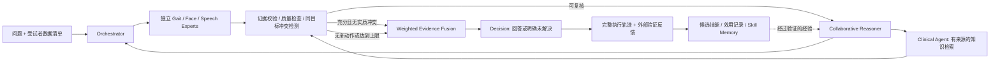

# PD_VQA

面向帕金森研究的**问题驱动、多专家证据分析、冲突复核与技能记忆**项目。

正式任务是同一受试者的**步态视频、面部视频、语音**问答；三类记录可以异步采集，保持各自时间轴。当前代码采用最新讨论的 Agent 工作流；旧项目的 UFNet、解耦、锚点和 MoE 实验不作为本项目默认前端。



## 已实现的功能

- 问题任务识别、多意图拆分、按工具能力激活专家，生成绑定受试者/记录的任务包；描述和测量不误启分类流，缺失能力单独报告。
- 真实音视频质量计算、可选姿态/面部/声学测量、冻结编码器适配。
- 每模态独立 `Conv1D → Self-Attention + Residual → Masked Pooling → Classifier`。
- 预测概率、归一化预测熵、测量单位、记录 ID、工具版本和时间窗口一起传递。
- 先检查预测目标与类别定义，再比较专家；不同症状不是冲突。
- 只执行清单中预声明的时间窗口动作；每轮最多复核每模态一次，同一动作不重复执行，总轮数有上限。
- 历史证据不覆盖；融合同时保留原报告和权重。无检查点不生成疾病概率，无法解决的分歧不靠多数票掩盖。
- DeepSeek API 用于任务识别、允许动作选择、最终证据选择；最终类别和测量文本由程序从真实证据渲染，离线流程不调用付费接口。
- SQLite 技能库：候选、外部反馈、效用排序、失效经验退出检索、冻结测试记忆。
- 单专家训练、按受试者验证选模型、独立测试和受试者级评价。

**运行边界：**目前没有你的正式三模态数据、训练后的专家权重和经审核的临床知识库。离线 demo 只验证工程流程；不能作为诊断效果。质量门限与融合权重是可审查基线，不等同 QA-MoE，也不是完整复现 SkeMex。

## 服务器快速开始

项目部署在 `/yepeng/PD_VQA`，独立环境为 `.venv`，复用服务器已有 PyTorch，不修改其他项目。

```bash
cd /yepeng/PD_VQA
source .venv/bin/activate
python -m pytest -q
python -m pd_vqa demo --out runs/demo_001
python -m pd_vqa model-smoke --device cuda --out runs/model_smoke_001.json
```

demo 创建一段前半部削波、后半部正常的**合成音频**，实际计算质量、选择允许窗口重新计算，并写出 `result.json`、`trace.jsonl`、`answer.md`。再次运行请换输出目录。

执行前可预览编排：`python -m pd_vqa plan --case examples/case.example.json --question '描述步态表现' --out runs/plan_001.json`。正式运行还会保存 `plan.json`，记录各专家的任务、分类开关与阻塞原因。详见 [Orchestrator 设计与用法](docs/orchestrator.md)。

新机器安装最小控制流程：`pip install -e '.[dev]'`。音视频和编码器增加 `pip install -e '.[models]'`；姿态、面部与详细声学计算增加 `pip install -e '.[measurements]'`。后者需要对应 Python 版本的二进制依赖和 MediaPipe task 模型。

## 接入真实数据

复制 [案例清单](examples/case.example.json)，填写同一受试者的记录、采集任务与真实路径。相对路径按 JSON 文件所在目录解析；一个案例每模态只选择一条明确记录。`windows` 是**已有录像内可执行的候选窗口**，不是医生症状标注；当前版本不会自动定位临床异常。记录长短不一时不跨模态强制时间对齐。

```bash
python -m pd_vqa validate --case examples/case.example.json
python -m pd_vqa run --case examples/case.example.json \
  --question '请总结步态视频中的可用测量及其局限' \
  --target gait_observation --modalities gait --out runs/P001_gait
```

没有视觉模型时只能获得视频元数据与清晰度代理，不代表已测量摆臂。配置 `landmark_model` 后才调用 MediaPipe。没有任何可用数据时正常返回证据不足。

## 编码、训练和评价

```bash
python -m pd_vqa download-models --root models --modalities gait face speech
python -m pd_vqa extract --case examples/case.example.json --model-root models \
  --device cuda --out data/features/P001
# 按 training.example.jsonl 为全部受试者建立清单和预先固定的数据划分。
python -m pd_vqa train --manifest data/train.jsonl --modality gait --target pd_presence \
  --labels healthy pd --epochs 30 --device cuda --out runs/gait_seed42
python -m pd_vqa evaluate --manifest data/train.jsonl --checkpoint runs/gait_seed42/best.pt \
  --split test --device cuda --out runs/gait_seed42/test.json
```

面部、语音各自训练；在病例 JSON 填入各自 `checkpoint` 和 `feature_cache` 或 `model_root`。编码器身份、版本、预处理和维度会与训练检查点绑定，不接受任意同维度特征。缓存缺少采集质量时标为未知，不能当作高质量观测。

四分类训练使用 `--target severity --labels 0 1 2 3 --label-definition data/group_definition.txt`；问答提供相同的定义文件。分组定义哈希与检查点绑定。0–3 不自动解释为某项 MDS-UPDRS 分数。工程情绪数据不能改成帕金森标签。

训练/验证/测试按人隔离；同一人的所有模态、重复记录和 QA 保持同一划分。最终指标先平均同一人多个记录的预测，再算 AUROC、Macro-F1 等。当前训练入口是简单基线，不声称与 UFNet 原文协议一致。

## DeepSeek 与临床知识

将 `.env.example` 复制为 `.env` 并填写账户实际支持的模型 ID和密钥。文件不入库；CLI 不自动读取它。

```bash
set -a
source .env
set +a
python -m pd_vqa run --case data/P001.json --question '这些数据支持什么结论？' \
  --target pd_presence --online --out runs/P001_online
```

API 只接收工具结构化结果，不上传原始文件、训练标签或文件路径。当前版本约束 API 选择已有证据 ID，最终类别、数值和单位由程序渲染；API 自由生成的医学断言不会直接替换答案。Clinical Agent 通过 `--knowledge` 读取有来源、任务范围的 JSON 知识卡；示例卡是未审核候选，不是正式临床知识库。

## 反思与技能进化

```bash
# 仅开发/训练轨迹允许提炼候选；提炼后不会立即参与检索。
python -m pd_vqa reflect --run runs/dev_case/result.json --memory data/skills.sqlite --split development
# 在外部验证后，填写可追溯的验证记录 ID。
python -m pd_vqa feedback --memory data/skills.sqlite --skill-id <ID> \
  --source tool_validation --reference-id <外部验证记录ID> --split development --success true
# 测试/问答只读经验库。
python -m pd_vqa run --case data/P001.json --question '分析步态证据' \
  --memory data/skills.sqlite --out runs/P001_memory
```

质量改善与诊断正确分开评价；专家一致不充当外部反馈。当前技能提炼采用确定性可执行动作记录，DeepSeek 规划可读取已验证技能。效用采用简化成功/失败统计，尚未实现 SkeMex 的窗口式优势估计、三分支语义检索和完整技能治理。

模块动机、来源与代码对应见 [架构设计](docs/architecture.md)；已核对的官方代码版本见 [来源锁定](references/sources.lock.json)。
