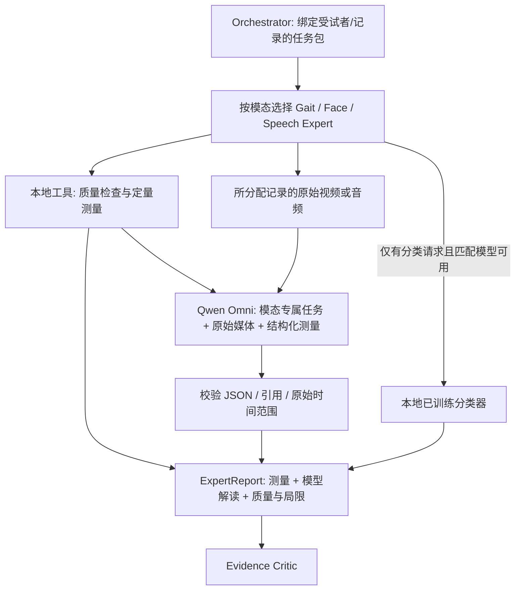

# 三个 Expert 的工具与多模态分析

## 数据流与职责



三个类 `GaitExpert`、`FaceExpert`、`SpeechExpert` 位于 `pd_vqa/experts.py`。它们共享执行与校验结构，分别配置关注点；`MultimodalExpertTools` 对接现有 Orchestrator 的能力注册、分析和复核接口。全局问题和单专家的局部任务分开，其他模态由其他专家负责。

参考 MedAgent-Pro §3.3 的“工具分析 → 逐步检查证据”，以及 BioGait-VLM 的视觉信息与显式测量结合思想。这里通过供应商 API 上传原始媒体，视觉/音频编码在服务端完成；没有上传自定义特征 Token，也没有复现论文的可训练投影、TED 或 SKEL。

## 三种专家的工具

| Expert | 实际测量工具 | 模型分析关注点 |
| --- | --- | --- |
| Gait | OpenCV 解码/清晰度；配置 Pose Landmarker 后计算躯干尺度归一化的手臂位置变化 IQR、踝间距变化 IQR、躯干倾斜变化 IQR | 可见步行动作、摆臂与姿态、视角和遮挡；不能从未标定的 2D 图像输出米制步长 |
| Face | OpenCV；配置 Face Landmarker 后提取有效正面帧的面部 blendshape、口唇运动、头姿及符合采样条件的眨眼指标 | 可见面部动作；区分采集任务、视角、检测缺失与表情减少 |
| Speech | RMS、削波比例、时长；按任务调用 librosa、WebRTC VAD、Praat 的基频/能量/停顿或持续元音测量 | 原始声音、发声与节律；语言内容和声学表现分别分析 |

语音 `capture_task` 必须按真实任务填写 `continuous` 或 `sustained_vowel`；未知时用 `unspecified`，仅保证基础测量。没有关键点模型时不伪造运动学数值，元数据和清晰度不等于症状指标。眨眼计数保留原生帧率并要求至少15 fps、至少3秒有效观测等工程条件。

测量资产官方地址：

- [Pose Landmarker Lite](https://storage.googleapis.com/mediapipe-models/pose_landmarker/pose_landmarker_lite/float16/latest/pose_landmarker_lite.task)，服务器路径 `models/measurement_tools/pose_landmarker_lite.task`。
- [Face Landmarker](https://storage.googleapis.com/mediapipe-models/face_landmarker/face_landmarker/float16/latest/face_landmarker.task)，服务器路径 `models/measurement_tools/face_landmarker.task`。

首次下载后在服务器 `models/measurement_tools/sources.json` 保存来源与文件 SHA256；正式研究应固定这些文件。示例配置见 `examples/case.qwen.example.json`，相对路径按清单位置解析。

Linux 上 MediaPipe 原生运行库还需要 EGL/GLES。当前 Ubuntu 服务器已安装 `libgles2`、`libegl1` 及其依赖，并实际验证 CPU 推理；仅能 `import mediapipe` 不表示关键点检测能够启动。

## 输入、输出与检查

`QwenAPI` 位于 `pd_vqa/qwen.py`，使用 [官方 Qwen-Omni 协议](https://help.aliyun.com/zh/model-studio/qwen-omni)，支持音频 `input_audio` 与视频 `video_url`。采用流式文本输出、完整结束标记校验和 JSON 解析；网络、截断、无效响应不会冒充成功结果。请求关闭思考输出，不存储隐式推理过程。

每次传入所分配模态的真实媒体、问题与局部任务、实际测量和局限。路径、密钥、训练标签不进提示词；媒体本身和记录/证据 ID 会发送到所配置的供应商接口。默认 `local` 不上传，显式 `--expert-backend qwen` 才启用。

`ExpertReport` 保留三个不同来源：

| 字段 | 来源与解释 |
| --- | --- |
| `evidence` | 本地计算的数值与单位、质量、时间、工具版本；`media_input` 记录原始源和实际提交片段的哈希，不代表已验证症状 |
| `findings` | Qwen 生成的解读，含 `observed / uncertain / not_assessable`、证据引用、原始时间范围；明确标记 `model_interpretation_unverified` |
| `prediction` | 仅由已训练本地分类器产生的概率；模型未训练、目标不匹配、未请求分类时不生成 |

`semantic_status` 为 `complete / insufficient / failed / unavailable / not_requested`；“完成模型分析”不等于模型结论经过医生审核或临床正确。LLM 不产生诊断概率或质量分数，也不覆盖工具测量。`quality` 是本地工程代理，预测熵是分类器输出的未校准不确定性；两者都不表示医学错误概率。

JSON 只接受 `findings / limitations / evidence_sufficient`。肯定观察必须引用已存在的媒体/测量证据，不能仅引用潜在特征；无法评估的陈述允许空引用并按证据不足处理。时间段须位于所提交原始区间内。复核仅上传对应窗口，提示模型将片段时间加回原始起点；源哈希和身份绑定仍保留。模型声称的数值/描述仅为未核验解读，不作为新的定量测量。

API 或格式失败时保留独立测量，Critic 标记证据不足；本地可选姿态/编码器等失败时尽力保留独立的基础质量测量。没有原始媒体时不能用缓存向量冒充多模态输入。当前不自动检测模型文字中的所有细微医学错误；诊断请求仍需匹配分类模型，不能靠模型自报“证据充分”通过。

最终回答将实际测量与“模型解读（待核验）”分开。当前跨专家的语义冲突仍比较可比分类概率，没有训练新的自由文本冲突检测器；不能把新增多模态接口当成已解决全部研究问题。

## 使用方式

服务器私有配置 `.env.qwen` 权限为0600，并被 Git 忽略。CLI 不自动读取环境文件：

```bash
cd /yepeng/PD_VQA
source .venv/bin/activate
set -a
source .env.qwen
set +a

# 预览计划，不上传媒体。
python -m pd_vqa plan --case examples/case.qwen.example.json \
  --question '请分别分析步态、面部动作和语音表现，并说明测量局限' \
  --expert-backend qwen --out runs/P001_qwen_plan.json

# 将示例中的数据路径改成真实文件后执行。
python -m pd_vqa run --case examples/case.qwen.example.json \
  --question '请分别分析步态、面部动作和语音表现，并说明测量局限' \
  --expert-backend qwen --max-reviews 1 --out runs/P001_qwen
```

API 需要阿里云百炼相应地域的 Key；`QWEN_BASE_URL` 和 `QWEN_MODEL` 可配置。`--online` 是原有 DeepSeek 控制流程开关，与专家 Qwen 分开；仅启用 Qwen 不会调用 DeepSeek。

为控制单次请求，初始实现每个片段最多60秒、原始内联媒体最多7 MB，总 JSON 请求最多10 MB。超出时报告失败并保留测量，不静默截断；请预先裁剪并记录正确来源，或在清单配置可用复核窗口。最多执行一次初始分析加设定数量的复核；没有自动网络重试。

正式受试者数据、疾病分类权重、临床解释准确性尚待接入和评价。合成视频/音频仅检验接口与证据流程，不充当帕金森样本，也不计算诊断分数。
